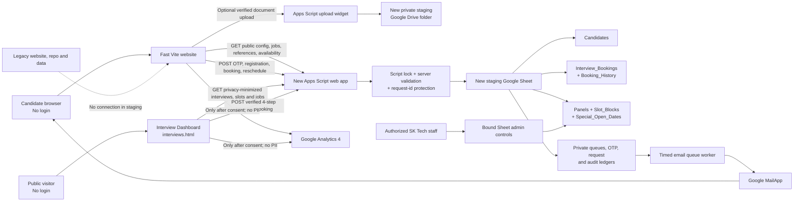
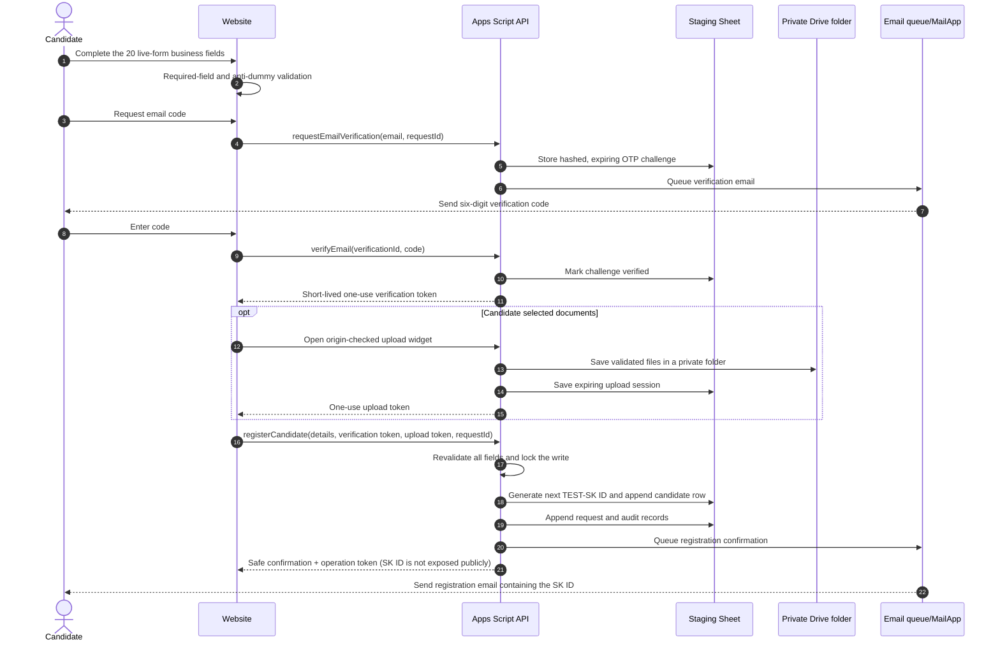
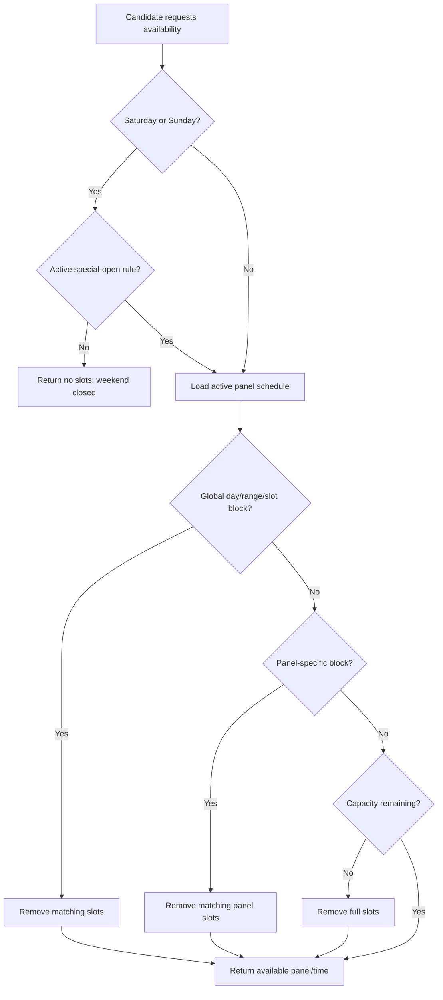
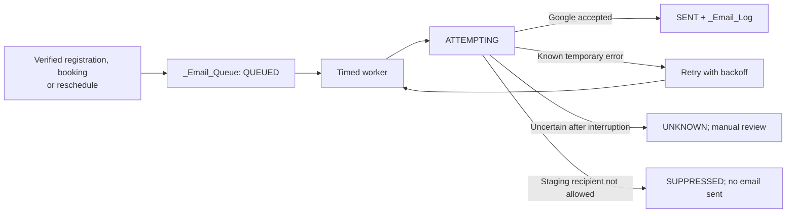
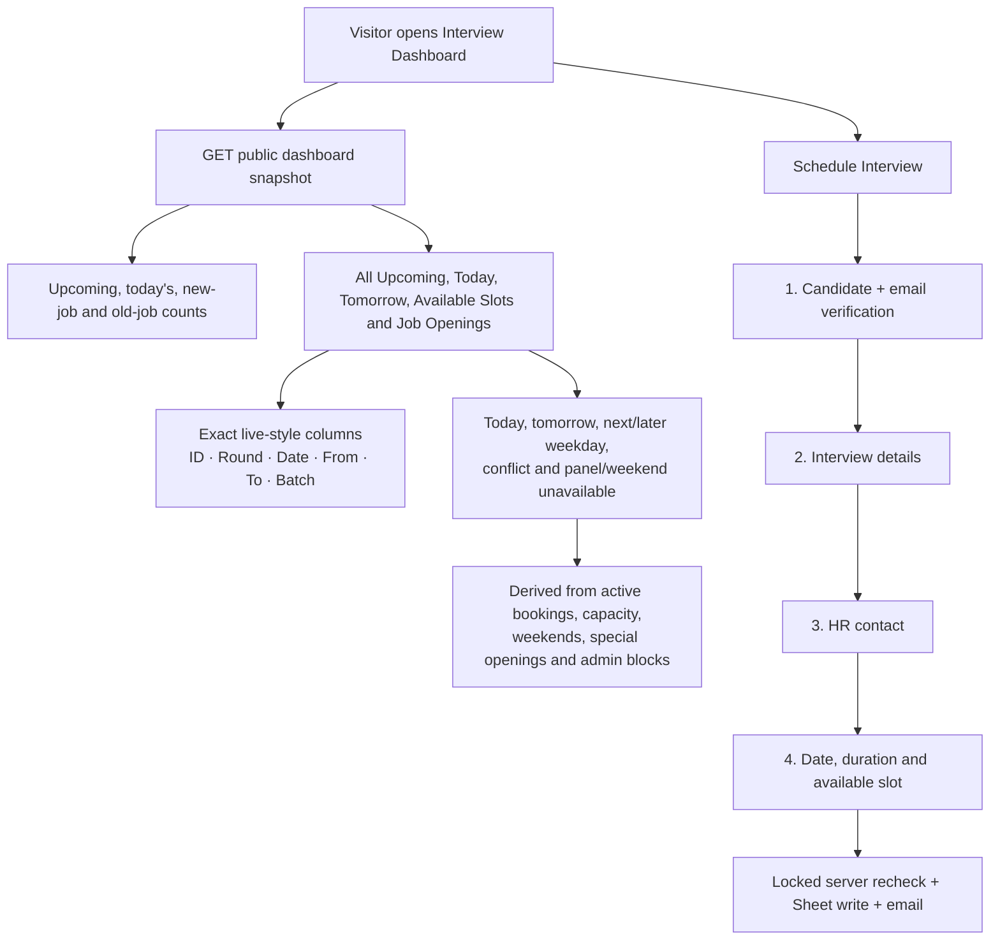

# SK Tech website v2 architecture

## Scope and safety boundary

This is a new, isolated website and data workflow. It does not call Google Forms and it does not read, merge, or modify the legacy website, repository, Apps Script project, or Google Sheet. Staging generates `TEST-SK...` and `TEST-BK-...` identifiers so test records cannot be confused with production records.

Legacy migration is deliberately outside this phase. It starts only after the owner accepts the complete staging website. See [Legacy migration boundary](#legacy-migration-boundary).

## End-to-end system



The website stays responsive because the browser loads static HTML, CSS, and JavaScript first. Google Sheets is never loaded directly in a visitor's browser; every read and write goes through the Apps Script validation layer. The Interview Dashboard is intentionally public and read-only apart from its candidate booking modal. Private administration remains inside the staging Google Sheet.

## Candidate registration



Registration rules:

1. No account or password is required.
2. Email ownership is verified before the candidate record is saved.
3. Both browser and server reject obvious dummy values such as `shiva123`, repeated digits, placeholder text, invalid phones, and malformed/test email addresses.
4. Optional files are checked for size, extension, MIME pairing, and file signature. They remain private; the code does not enable link sharing.
5. The Sheet write and SK ID allocation occur under a script lock, preventing two simultaneous requests from taking the same ID.
6. The public response does not reveal the SK ID. The verified candidate receives it by email.
7. A client-generated `requestId` makes a technical retry safe. Reusing the same ID with changed data is rejected.

## Interview booking

```mermaid
sequenceDiagram
    autonumber
    actor C as Candidate
    participant W as Website
    participant A as Apps Script API
    participant S as Staging Sheet
    participant M as Email queue/MailApp

    C->>W: Enter registered email, SK ID and interview details
    C->>W: Choose date and duration
    W->>A: availability(date, duration)
    A->>S: Read panels, bookings, blocks and special openings
    A-->>W: Only currently available panel/time choices
    C->>W: Select a panel/time and verify registered email
    W->>A: bookInterview(details, selected slot, verification token, requestId)
    A->>A: Validate candidate and recheck slot while locked
    alt Slot is still available
        A->>S: Append booking and CREATED history event
        A->>M: Queue candidate confirmation and optional staff notification
        A-->>W: Booking confirmed + public reference
        M-->>C: Email booking details and private manage token
    else Blocked or capacity reached
        A-->>W: Reject safely; ask candidate to choose another slot
    end
```

### Intentional repeat bookings are not duplicates

The duplicate rule is technical, not business-based:

- The same `requestId` and same payload replay the original safe response.
- The same `requestId` with changed data is rejected.
- A new `requestId` is a new intentional booking, even when candidate, company, round, date, and time match another booking.
- A candidate may have multiple interviews on the same day.
- Panel capacity and active blocking rules always apply.

This means a rescheduled interview, a second interview on the same day, and a deliberately repeated set of interview details are not silently discarded as duplicates.

## Rescheduling

```mermaid
sequenceDiagram
    autonumber
    actor C as Candidate
    participant W as Website
    participant A as Apps Script API
    participant S as Staging Sheet
    participant M as Email queue/MailApp

    C->>W: Open booking reference + private manage token from email
    W->>A: bookingLookup(reference, token)
    A-->>W: Safe booking summary with no contact PII
    C->>W: Choose another available date, panel and time; enter reason
    W->>A: rescheduleInterview(new schedule, reason, requestId)
    A->>A: Verify capability token and recheck availability while locked
    A->>S: Mark prior row RESCHEDULED
    A->>S: Append linked booking version and history event
    A->>M: Queue updated confirmation with a fresh secure link
    A-->>W: Reschedule confirmed
    M-->>C: Send the new booking details
```

The prior booking is preserved. `previousBookingId`, `rootBookingId`, and `version` link every version, while `Booking_History` provides an append-only event trail.

## Availability, weekends, and admin blocks



Admin controls use three sheets:

- `Panels` defines the panel, working weekdays, operating window, slot length, and capacity.
- `Slot_Blocks` can disable one panel or all panels for a slot, day, or date range.
- `Special_Open_Dates` explicitly opens a normally closed date, including a weekend, for one or all panels.

The browser hides blocked choices, but that is only convenience. Booking and rescheduling repeat the same check under the write lock, so a stale browser cannot take a newly blocked slot.

The source includes a private bound-Sheet admin sidebar for easier rule creation. It is separate from the public Interview Dashboard and never sends candidate/HR records or private control data to that page. Launching the sidebar in the new workbook remains part of deployment acceptance; authorized staff can manage the same rows directly in the staging tabs meanwhile.

## Email delivery and auditability



Staging mail is restricted to the configured exact allowlist and/or `mysktech.com` domain. The restriction is checked before OTP queueing and again by the mail worker. This prevents accidental messages to real candidates while testing.

## Google Sheet data map

| Area | Tabs | Purpose |
| --- | --- | --- |
| Candidate data | `Candidates` | Generated SK ID, live-form fields, private document links, consent and status |
| Interview data | `Interview_Bookings`, `Booking_History` | Current/prior booking versions and append-only change history |
| Availability | `Panels`, `Slot_Blocks`, `Special_Open_Dates` | Capacity, weekday hours, closures and exceptions |
| Website content | `Jobs`, `Reference_Data`, `Settings` | Public jobs, select options and non-secret runtime configuration |
| ID safety | `_Sequences` | New staging ID counters |
| Delivery | `_Email_Queue`, `_Email_Log` | Queued messages, retries and delivery audit |
| Security | `_Otp_Challenges`, `_Upload_Sessions` | Hashed OTP state and expiring private-upload state |
| Reliability | `_Request_Log`, `_Audit_Log` | Idempotency results and action audit |

Tabs beginning with `_` are hidden for usability, but hiding is not access control. Only trusted staff should have edit access to the workbook.

## Analytics and privacy

GA4 is configured from the new Sheet and loads only after the visitor accepts analytics. Events pass through a defensive sanitizer. Names, email addresses, phone numbers, SK IDs, booking references, OTPs, manage tokens, form answers, and the private URL fragment are excluded.

Candidate and HR details stay in the new private Google Workspace data stores. Public list and status APIs return only the minimum safe fields needed by the website.

## Public Interview Dashboard

The live-style dashboard is implemented as a separate public page at `interviews.html`; it does not require a login. It uses the official SK Tech logo asset and the blue, orange, teal and navy brand palette. The page is a privacy-minimized operational view, not an administration screen.



The public table deliberately exposes only the six fields used by the existing live dashboard: SK ID, round, date, from, to and batch. It excludes candidate name, candidate email and phone, HR name/email/phone, the booked interview's company, internal booking IDs, manage tokens, request IDs, internal panel names and block reasons. Available-slot output uses public labels and aggregated remaining capacity rather than internal panel identifiers. Public job cards may still show the employer name supplied for an active job opening.

Conflict and availability states are computed on the server:

- overlapping interviews for the same candidate are marked as conflicts, while separate non-overlapping interviews on the same day remain valid;
- panel overlaps beyond configured capacity are marked as conflicts;
- inactive/missing panels, out-of-window bookings, weekends without a special opening and active panel/global blocks are marked unavailable;
- the Available Slots view removes elapsed, blocked, closed and full choices; and
- the Job Openings view includes active public job data with new/old filters, search, employment-type filtering, sorting and pagination.

The dashboard's four-step modal captures the same 14 booking business fields documented in [LIVE_FIELD_PARITY.md](LIVE_FIELD_PARITY.md). Email verification, duration and panel-slot selection are workflow controls, not replacements for those fields. The server rechecks availability under a lock before saving, so dashboard refresh timing cannot override a newer booking or admin block.

### Public dashboard versus private administration

| Public Interview Dashboard | Private Google Sheet administration |
| --- | --- |
| No login; read-only schedule/slot/job summaries plus candidate booking | Restricted to authorized Sheet editors |
| Six privacy-minimized interview columns | Full candidate, HR, booking, audit and delivery records |
| Shows computed conflicts and unavailability without private reasons | Creates/edits panels, blocks, special openings and jobs |
| Never exposes manage tokens, contact data or internal panel names | Includes the bound-Sheet admin sidebar and direct staging tabs |

The dashboard source and server-side privacy/conflict tests are implemented. A real deployed Apps Script read, booking write and email delivery remain part of staging deployment acceptance.

## Legacy migration boundary

There is no migration connection now. After staging acceptance, migration should be a separate, reviewed operation:

1. Take an immutable backup/export of old data.
2. Define exact old-to-new column mappings and validate required fields.
3. Copy old candidates while preserving every existing SK ID.
4. Copy old interview history without treating valid repeated/same-day interviews as duplicates.
5. Reconcile rejected rows explicitly; never silently drop them.
6. Set the new candidate sequence above the highest verified old numeric SK ID.
7. Run collision, row-count, and sample-record checks.
8. Perform one controlled production registration and booking.
9. Cut over only after Sheet, email, availability, and analytics evidence passes.

The old and new production ID generators must never run concurrently.
